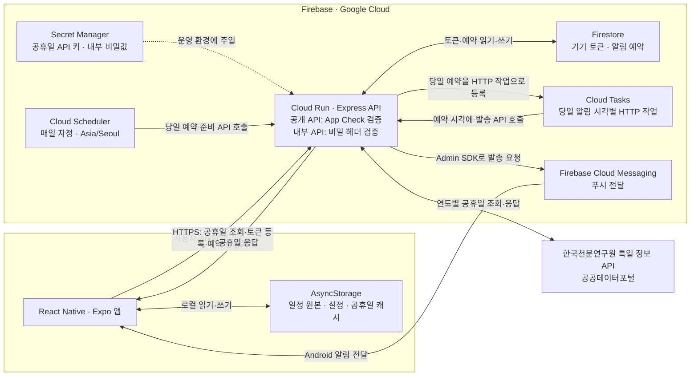

# Checklendar

Checklendar는 달력과 체크리스트를 결합한 일정 관리 앱입니다. 일정을 날짜 범위로 관리하고, 대한민국 공휴일을 표시하며, Firebase Cloud Messaging과 Google Cloud를 이용해 서버 기반 알림을 전송하는 대학 졸업 프로젝트입니다.

현재 Android 앱은 배포되어 운영 중이며, 기능 개선과 알림 안정성·클라우드 사용량 관리를 진행합니다.

## 개발·운영 현황

| 영역 | 상태 | 설명 |
| --- | --- | --- |
| Android 앱 | 배포 완료·운영 중 | 일정 관리 및 서버 기반 알림 서비스 제공 |
| 달력·체크리스트 | 완료 | 일정 등록, 수정, 삭제, 완료 처리 및 날짜 범위 표시 |
| 일정 데이터 | 완료 | AsyncStorage 기반 로컬 저장 및 Repository 분리 |
| 공휴일 | 구현 완료 | 한국천문연구원 특일 정보 API 연동, 달력 빨간 날짜 표시 |
| 공휴일 캐시 | 구현 완료 | 현재·미래 연도 30일 캐시, 과거 캐시 보관 기간 설정 |
| 푸시 토큰·예약 동기화 | 구현 완료 | Android FCM 토큰 등록 및 Firestore 예약 동기화 |
| 푸시 발송 | 구현 완료 | Firebase Admin SDK 직접 발송 및 만료 토큰·예약 삭제 |
| Cloud Run | 배포 완료 | 서울 리전, 최소 인스턴스 0 |
| Cloud Tasks | 생성 완료 | 알림 예약 발송용 큐 생성 |
| Cloud Scheduler | 연결 완료 | 매일 자정 당일 알림 준비 작업 실행 및 강제 실행 검증 완료 |
| 앱 실배포 연결 | 완료 | Cloud Run 연결 및 Android FCM 직접 발송 실기기 검증 완료 |

## 주요 기능

- 달력에서 단일·다중 날짜 일정 등록
- 일정 수정, 삭제 및 완료 상태 전환
- 일정 카드를 길게 눌러 제목·기간·완료 상태·메모 상세 보기
- 일정별 색상 선택과 겹침을 고려한 자동 색상 지정
- 월별 체크리스트 화면과 시작 화면 선택
- 다크 모드 및 달력 월 표시 형식 설정
- 하단 메뉴 핸들바를 아래로 드래그해 닫기
- 대한민국 공휴일 날짜와 명칭 표시
- 공휴일 데이터의 오프라인 캐시와 과거 캐시 보관 기간 설정
- 사용자 지정 시각의 일정 요약 푸시 알림
- 알림 해제 또는 만료 시 FCM 토큰과 남은 예약 삭제
- Cloud Run 서비스 계정을 이용한 키 파일 없는 FCM 서버 인증

## 시스템 구성

Checklendar는 **일정 원본을 기기에 저장하는 Android 앱**과 **공휴일 조회·알림 예약을 처리하는 Cloud Run 서버**로 구성됩니다. 로그인 없이 사용하며, 일정 제목과 메모는 서버로 전송하지 않습니다. 현재 서버 푸시 알림은 Android에서 지원합니다.

### 전체 연결도



앱의 서버 요청에는 Firebase App Check 토큰을 첨부합니다. 릴리스 앱은 Play Integrity, 개발 빌드는 등록된 디버그 토큰을 사용합니다. 앱은 Cloud Run API를 통해 토큰·예약을 관리하며, Firestore에 대한 클라이언트 직접 읽기·쓰기는 [`firestore.rules`](firestore.rules)에서 차단합니다.

### 데이터 저장 위치와 역할

| 저장 위치 | 저장하는 데이터 | 역할 |
| --- | --- | --- |
| 기기 AsyncStorage | 일정 제목·메모·기간·완료 상태·색상, 사용자 설정 | 일정 원본 저장. 달력·체크리스트는 이 데이터를 사용 |
| 기기 AsyncStorage | 연도별 공휴일 캐시, 등록 토큰·마지막 동기화 정보 | 오프라인 조회와 중복 서버 요청 감소 |
| Firestore `pushTokens` | FCM 토큰, 플랫폼, 활성 상태, 시간대, 갱신 시각 | 알림을 받을 기기 관리 |
| Firestore `scheduledNotifications` | 대상 토큰, 알림 ID·시각, 요약 알림 제목·본문, 처리 상태·버전 | 서버가 발송할 예약 관리. 일정 원본의 백업 용도로 사용하지 않음 |
| Cloud Run 프로세스 메모리 | 연도별 공휴일 응답 캐시 | 외부 공휴일 API 호출 감소. 인스턴스별로 유지되며 재시작하면 사라짐 |

예를 들어 같은 날 미완료 일정이 3개라면, 앱은 일정 제목 3개 대신 `오늘 아직 완료하지 않은 할 일이 3개 있습니다.`라는 요약 알림을 생성합니다. 서버에 저장되는 `title`과 `body`는 이 알림의 제목·본문입니다.

### 알림 처리 흐름

1. **기기 등록:** 사용자가 알림을 켜고 권한을 허용하면 앱이 Android FCM 토큰을 얻어 `/api/register-token`에 등록합니다.
2. **예약 계산:** 앱이 로컬 일정에서 미완료 일정이 있는 날짜마다 사용자 지정 시각의 요약 알림을 하나씩 만듭니다. 기기 현지 시각을 UTC ISO 시각으로 변환하며, 이미 지난 알림 시각은 제외합니다.
3. **예약 동기화:** `/api/notification-schedule`로 기기별 최신 예약 목록 전체를 보냅니다. 서버는 Firestore에서 새 예약·변경된 예약을 저장하고, 목록에서 빠진 예약을 삭제합니다. 일정의 연속 변경은 앱에서 500ms 동안 묶어 요청하며, 앱 시작·복귀 시 같은 날짜·시간대·토큰·목록이면 중복 동기화를 생략합니다.
4. **당일 작업 준비:** Cloud Scheduler가 매일 자정 `Asia/Seoul` 기준으로 `/internal/prepare-daily-notifications`를 호출합니다. 서버가 Firestore의 당일 예약을 읽어 Cloud Tasks에 등록합니다. 당일 일정이 바뀌면 동기화 직후 작업을 등록하므로 다음 자정까지 기다리지 않습니다.
5. **발송:** Cloud Tasks가 예약 시각에 `/internal/send-notification`을 호출합니다. 서버는 예약 존재 여부·버전·기기 등록 상태를 확인하고, Firestore 트랜잭션으로 처리 상태를 선점한 뒤 Firebase Admin SDK로 FCM 발송을 요청합니다.
6. **정리:** FCM 발송 요청이 성공하면 해당 Firestore 예약을 삭제합니다. 사용자가 알림을 끄거나 FCM이 만료·유효하지 않은 토큰 오류를 반환하면 토큰 문서와 연결된 예약을 삭제합니다.

Firestore는 미래 알림 목록을 보관하고, Cloud Tasks는 그중 당일 발송할 HTTP 작업을 실행합니다. 이미 생성된 오래된 Cloud Task는 실행 시 예약이 삭제됐거나 버전이 바뀌었으면 발송을 건너뜁니다. 일반적인 발송 오류는 예약을 대기 상태로 되돌리고 HTTP 오류를 반환해 Cloud Tasks 재시도 대상으로 처리합니다.

앱은 현재부터 **30일 이내·최대 30건**을 동기화하고, 서버는 입력 검증에서 **31일 이내·최대 30건**을 허용합니다. 그보다 먼 일정은 이후 앱 실행·복귀 또는 일정·설정 변경으로 다시 동기화할 때 범위에 들어오면 예약됩니다. 알림의 미완료 개수는 마지막으로 성공한 동기화 시점의 값입니다.

Cloud Tasks 필수 환경변수가 모두 갖춰지지 않으면 서버는 **1분 간격 Firestore 폴링 모드**로 전환합니다. 이 모드는 계속 실행 중인 로컬 서버에서 사용하며, Cloud Scheduler·Cloud Tasks 없이 FCM에 발송합니다.

### 공휴일 처리 흐름

1. 앱이 표시할 연도의 로컬 캐시를 확인합니다.
2. 현재·미래 연도 캐시가 30일 이내라면 서버를 호출하지 않습니다. 과거 연도 캐시는 보관 기간 안에서 재사용합니다.
3. 캐시가 없거나 만료되면 App Check 토큰을 첨부해 Cloud Run의 `/api/holidays`를 호출합니다.
4. 서버는 7일간 유효한 메모리 캐시를 먼저 확인합니다. 없으면 서버에 보관한 API 키로 한국천문연구원 특일 정보 API를 조회하고 XML을 날짜·이름 배열로 변환해 반환합니다.
5. 앱은 응답을 로컬 캐시에 저장합니다. 요청이 실패하면 기존 캐시가 있을 때 이를 표시하고, 없으면 오류를 호출 화면에 전달합니다.

설정 화면에서 과거 공휴일 캐시를 1년, 3년, 5년 또는 10년 단위로 보관할 수 있습니다. 범위를 벗어난 데이터는 사용자 기기의 AsyncStorage에서 삭제됩니다.

## 기술 스택

### 앱

- React Native 0.81
- React 19
- Expo SDK 54
- Expo Router
- TypeScript
- React Native Calendars
- AsyncStorage
- Expo Notifications
- React Native Firebase App / App Check

### 서버·클라우드

- Node.js
- Express 5
- Firebase Admin SDK
- Firestore
- Firebase Cloud Messaging
- Google Cloud Run
- Google Cloud Tasks
- Google Cloud Scheduler
- Google Secret Manager
- Luxon

## 프로젝트 구조

```text
checklendar/
├── README.md
├── ROADMAP.md                   # 사용자 편의성 개선 후보
├── PLAY_RELEASE_CHECKLIST.md    # 업데이트·운영 점검
├── firestore.rules              # Firestore 클라이언트 직접 접근 차단
├── checklendar/                 # Expo 앱
│   ├── app/                     # Expo Router 화면
│   ├── components/              # 공통 일정 상세 팝업
│   ├── services/                # 로컬 일정 저장·알림 동기화·공휴일·App Check
│   ├── useNotifications.ts      # 알림 권한·FCM 토큰·앱 복귀 처리
│   ├── types/                   # 공통 타입
│   ├── utils/                   # 날짜·메뉴 제스처 유틸리티와 테스트
│   └── android/                 # Android 네이티브 프로젝트
└── server/                      # Express 백엔드
    ├── index.js                 # API 연결·예약 동기화·발송 선점·로컬 폴링
    ├── appCheckMiddleware.js    # 공개 API App Check 검증
    ├── rateLimitMiddleware.js   # 요청 빈도 제한
    ├── deviceRegistration.js    # 기기 등록 상한·토큰 및 예약 정리
    ├── holidayService.js        # 공휴일 API와 서버 캐시
    ├── notificationTaskManager.js # 당일 Cloud Task 생성·내부 발송 API
    ├── Dockerfile
    └── CLOUD_DEPLOYMENT.md
```

## 환경 설정

### 1. 앱 환경변수

`checklendar/.env` 파일을 만들고 백엔드 주소를 설정합니다.

```env
EXPO_PUBLIC_PUSH_SERVER_URL=https://your-cloud-run-service.run.app
```

이 주소는 공휴일 API와 푸시 알림 API가 함께 사용합니다. `.env`는 Git에 포함하지 않습니다.

Android 빌드에는 `checklendar/google-services.json`이 필요합니다. 개발 빌드는 Firebase Console에 등록한 App Check 디버그 토큰을 `.env.local`의 `EXPO_PUBLIC_FIREBASE_APP_CHECK_DEBUG_TOKEN`에 설정합니다. 릴리스 빌드는 Play Integrity를 사용합니다. 설정 예시는 [`checklendar/.env.example`](checklendar/.env.example), 서명·App Check 연결 절차는 [Play 체크리스트](PLAY_RELEASE_CHECKLIST.md)를 참고합니다.

### 2. 로컬 서버 환경변수

`server/.env.example`을 참고해 `server/.env`를 만듭니다.

```env
PORT=3000
PUBLIC_DATA_SERVICE_KEY=공공데이터포털_Decoding_인증키
GOOGLE_APPLICATION_CREDENTIALS=/absolute/path/to/firebase-service-account.json

CLOUD_TASKS_PROJECT_ID=your-google-cloud-project-id
CLOUD_TASKS_LOCATION=asia-northeast3
CLOUD_TASKS_QUEUE=checklendar-notifications
CLOUD_RUN_SERVICE_URL=https://your-cloud-run-service.run.app
INTERNAL_API_SECRET=충분히_긴_임의의_문자열
NOTIFICATION_TIMEZONE=Asia/Seoul
CLOUD_TASKS_SERVICE_ACCOUNT_EMAIL=
FIREBASE_ANDROID_APP_ID=1:PROJECT_NUMBER:android:APP_HASH
APP_CHECK_ENFORCEMENT=enforce
MAX_ACTIVE_NOTIFICATION_DEVICES=100
```

운영 환경에서는 API 키와 내부 비밀값을 Google Secret Manager에 저장합니다. Cloud Run에서는 서비스 계정의 Application Default Credentials를 사용하므로 서비스 계정 JSON 파일을 배포하지 않습니다.

로컬 폴링으로 실행하려면 `CLOUD_TASKS_*`, `CLOUD_RUN_SERVICE_URL`, `INTERNAL_API_SECRET` 설정을 생략합니다. 로컬에서도 Firestore·FCM 접근용 자격 증명과 공휴일 API 키는 필요합니다.

## 로컬 실행

### 앱

```bash
cd checklendar
npm install
npm run android
```

Metro 개발 서버만 실행하려면 다음 명령을 사용합니다.

```bash
npm start
```

### 서버

```bash
cd server
npm install
npm run check
npm test
npm start
```

서버 상태 확인:

```bash
curl http://localhost:3000/health
```

공휴일 확인(App Check 강제 검증이 기본값이므로 앱에서 발급받은 유효한 토큰 필요):

```bash
curl "http://localhost:3000/api/holidays?year=2026" \
  -H 'X-Firebase-AppCheck: <유효한_App_Check_토큰>'
```

## 검사 명령

```bash
# Expo 앱
cd checklendar
npm run lint
npx tsc --noEmit
node --test utils/menuPanResponder.test.cjs

# 서버
cd ../server
npm run check
npm test
```

앱의 메뉴 테스트는 드래그 이동·닫기·복귀·취소 로직을 검증합니다. 서버 테스트는 App Check, 요청 제한, 기기 등록 상한·삭제, 공휴일 응답 처리, Cloud Tasks 예약 생성 및 FCM 직접 발송을 검증합니다. Android 실기기의 터치 동작과 실제 알림 수신은 [Play 체크리스트](PLAY_RELEASE_CHECKLIST.md)에 따라 별도로 확인합니다.

## API

| 메서드 | 경로 | 호출 주체·용도 | 인증 헤더 |
| --- | --- | --- | --- |
| `GET` | `/health` | 서버 상태 확인 | 없음 |
| `GET` | `/api/holidays?year=YYYY` | 앱: 연도별 공휴일 조회 | `X-Firebase-AppCheck` |
| `POST` | `/api/register-token` | 앱: Android FCM 토큰 등록 | `X-Firebase-AppCheck` |
| `DELETE` | `/api/register-token` | 앱: Android FCM 토큰과 예약 삭제 | `X-Firebase-AppCheck` |
| `PUT` | `/api/notification-schedule` | 앱: 기기별 알림 예약 전체 동기화 | `X-Firebase-AppCheck` |
| `POST` | `/internal/prepare-daily-notifications` | Cloud Scheduler: 당일 알림 Task 준비 | `x-internal-secret` |
| `POST` | `/internal/send-notification` | Cloud Tasks: 예약 알림 발송 | `x-internal-secret` |

공개 `/api/*`에는 IP 단위 요청 제한을 적용하고, 토큰 등록·삭제 및 예약 동기화에는 IP·토큰 조합의 추가 제한을 적용합니다. App Check는 앱 요청을 검증하며 사용자 로그인 인증으로 사용하지 않습니다. 내부 API는 Cloud Tasks 모드에서만 활성화됩니다.

## Google Cloud 배포 현황

- Google Cloud 프로젝트: `checklendar-e5327`
- 리전: `asia-northeast3`
- Cloud Run 서비스: `checklendar-api`
- Cloud Tasks 큐: `checklendar-notifications`
- Cloud Run 최소 인스턴스: `0`
- Cloud Run 최대 인스턴스: `3`
- Cloud Tasks 제한: 초당 `5`, 동시 `2`, 최대 재시도 `5`
- 활성 알림 기기 제한: 최대 `100`대
- 공개 API: Firebase App Check 강제 검증, IP·기기 토큰 단위 요청 제한
- Secret Manager:
  - `public-data-service-key`
  - `internal-api-secret`

현재 Cloud Run URL:

```text
https://checklendar-api-1045415573044.asia-northeast3.run.app
```

상세 배포 명령과 Scheduler 생성 방법은 [server/CLOUD_DEPLOYMENT.md](server/CLOUD_DEPLOYMENT.md)를 참고합니다.

## 보안 원칙

- 공공데이터 API 키와 Firebase 서비스 계정 파일을 Git에 커밋하지 않습니다.
- 운영 비밀값은 Secret Manager에 저장합니다.
- 로그에는 FCM 토큰 전체를 출력하지 않습니다.
- 내부 Cloud Tasks·Scheduler API는 별도의 비밀 헤더로 검증합니다.
- 공개 API는 Firebase App Check로 정상 앱에서 발급한 토큰만 허용합니다.
- 활성 알림 기기는 최대 100대로 제한하고, 등록된 토큰만 예약 동기화를 허용합니다.
- 예약은 기기당 최대 30개, 현재부터 31일 이내로 제한합니다.
- Cloud Run 서비스 계정에는 Firestore, Cloud Tasks, FCM, App Check 검증에 필요한 최소 권한만 부여합니다.

## 운영 및 후속 작업

사용자 편의성 개선 후보와 제안 우선순위는 [ROADMAP.md](ROADMAP.md)에 기록합니다.

- FCM·Cloud Tasks 사용량과 실패 로그 모니터링
- iOS 알림을 지원할 경우 APNs 또는 Firebase iOS 구성을 추가
- 미사용 Google Cloud 프로젝트 검토 후 정리

## 기여

Thanks to Unjea.
