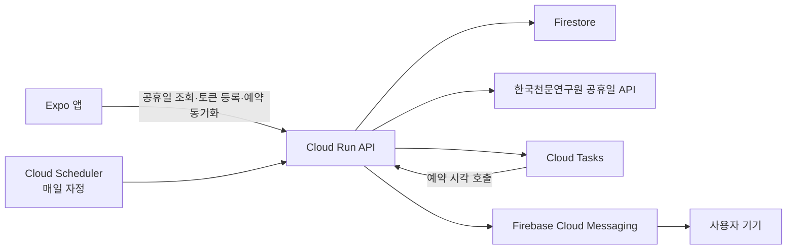

# Checklendar

Checklendar는 달력과 체크리스트를 결합한 일정 관리 앱입니다. 일정을 날짜 범위로 관리하고, 대한민국 공휴일을 표시하며, Firebase Cloud Messaging과 Google Cloud를 이용해 서버 기반 알림을 전송하는 대학 졸업 프로젝트입니다.

## 개발 현황

| 영역 | 상태 | 설명 |
| --- | --- | --- |
| 달력·체크리스트 | 완료 | 일정 등록, 수정, 삭제, 완료 처리 및 날짜 범위 표시 |
| 일정 데이터 | 완료 | AsyncStorage 기반 로컬 저장 및 Repository 분리 |
| 공휴일 | 구현 완료 | 한국천문연구원 특일 정보 API 연동, 달력 빨간 날짜 표시 |
| 공휴일 캐시 | 구현 완료 | 현재·미래 연도 30일 캐시, 과거 캐시 보관 기간 설정 |
| 푸시 토큰·예약 동기화 | 구현 완료 | Android FCM 토큰 등록 및 Firestore 예약 동기화 |
| 푸시 발송 | 구현 완료 | Firebase Admin SDK 직접 발송 및 만료 토큰·예약 삭제 |
| Cloud Run | 배포 완료 | 서울 리전, 최소 인스턴스 0 |
| Cloud Tasks | 생성 완료 | 알림 예약 발송용 큐 생성 |
| Cloud Scheduler | 연결 완료 | 매일 자정 당일 알림 준비 작업 실행 및 강제 실행 검증 완료 |
| 앱 실배포 연결 | 완료 | Cloud Run 연결 및 Android FCM 직접 발송 실기기 검증 완료 |

## 주요 기능

- 달력에서 단일·다중 날짜 일정 등록
- 일정 수정, 삭제 및 완료 상태 전환
- 일정별 색상 선택과 겹침을 고려한 자동 색상 지정
- 월별 체크리스트 화면과 시작 화면 선택
- 다크 모드 및 달력 월 표시 형식 설정
- 대한민국 공휴일 날짜와 명칭 표시
- 공휴일 데이터의 오프라인 캐시와 과거 캐시 보관 기간 설정
- 사용자 지정 시각의 일정 요약 푸시 알림
- 알림 해제 또는 만료 시 FCM 토큰과 남은 예약 삭제
- Cloud Run 서비스 ID를 이용한 키 없는 FCM 서버 인증

## 시스템 구성



### 알림 처리 흐름

1. 앱이 Android 네이티브 FCM 토큰을 서버에 등록합니다.
2. 앱의 일정이나 알림 설정이 바뀌면 미래 알림 목록 전체를 서버와 즉시 동기화합니다.
   앱 시작·복귀 시에는 날짜·시간대·토큰·예약 목록이 모두 같으면 하루 동안 중복 동기화를 생략합니다.
3. Cloud Scheduler가 매일 자정에 당일 예약 준비 API를 호출합니다.
4. 서버가 알림 시각별 Cloud Task를 생성합니다.
5. Cloud Tasks가 지정 시각에 Cloud Run의 내부 발송 API를 호출합니다.
6. Cloud Run이 Firebase Admin SDK로 FCM에 직접 알림을 전송합니다.
7. 만료된 등록 토큰 오류가 반환되면 토큰을 비활성화하고 해당 토큰의 남은 예약을 삭제합니다.

같은 날 일정이 추가되거나 변경되면 자정 작업을 기다리지 않고 동기화 직후 Cloud Task를 갱신합니다. 삭제되거나 내용이 바뀐 오래된 Task는 Firestore 문서 버전을 검사한 뒤 발송을 건너뜁니다.

Cloud Tasks 환경변수가 없는 로컬 서버에서는 1분 간격 폴링 방식으로 동작합니다.

### 공휴일 처리 흐름

1. 앱이 표시할 연도의 로컬 캐시를 확인합니다.
2. 현재·미래 연도 캐시가 30일 이내라면 서버를 호출하지 않습니다.
3. 캐시가 없거나 만료되면 Cloud Run의 `/api/holidays`를 호출합니다.
4. 서버는 한국천문연구원 특일 정보 API를 조회하고 결과를 7일간 메모리에 캐시합니다.
5. 네트워크 요청이 실패하면 앱은 마지막으로 저장된 캐시를 표시합니다.

설정 화면에서 과거 공휴일 캐시를 1년, 3년, 5년 또는 10년 단위로 보관할 수 있습니다. 범위를 벗어난 데이터는 사용자 기기의 AsyncStorage에서 삭제됩니다.

## 기술 스택

### 앱

- React Native 0.81
- React 19
- Expo SDK 54
- Expo Router
- TypeScript
- React Native Calendars
- AsyncStorage
- Expo Notifications

### 서버·클라우드

- Node.js
- Express 5
- Firebase Admin SDK
- Firestore
- Firebase Cloud Messaging
- Google Cloud Run
- Google Cloud Tasks
- Google Cloud Scheduler
- Google Secret Manager
- Luxon

## 프로젝트 구조

```text
checklendar/
├── README.md
├── checklendar/                 # Expo 앱
│   ├── app/                     # Expo Router 화면
│   ├── services/                # 일정·알림·공휴일 서비스
│   ├── types/                   # 공통 타입
│   ├── utils/                   # 날짜 유틸리티
│   └── android/                 # Android 네이티브 프로젝트
└── server/                      # Express 백엔드
    ├── index.js                 # 공개 API와 로컬 알림 처리
    ├── holidayService.js        # 공휴일 API와 서버 캐시
    ├── notificationTaskManager.js
    ├── Dockerfile
    └── CLOUD_DEPLOYMENT.md
```

## 환경 설정

### 1. 앱 환경변수

`checklendar/.env` 파일을 만들고 백엔드 주소를 설정합니다.

```env
EXPO_PUBLIC_PUSH_SERVER_URL=https://your-cloud-run-service.run.app
```

이 주소는 공휴일 API와 푸시 알림 API가 함께 사용합니다. `.env`는 Git에 포함하지 않습니다.

### 2. 로컬 서버 환경변수

`server/.env.example`을 참고해 `server/.env`를 만듭니다.

```env
PORT=3000
PUBLIC_DATA_SERVICE_KEY=공공데이터포털_Decoding_인증키
GOOGLE_APPLICATION_CREDENTIALS=/absolute/path/to/firebase-service-account.json

CLOUD_TASKS_PROJECT_ID=your-google-cloud-project-id
CLOUD_TASKS_LOCATION=asia-northeast3
CLOUD_TASKS_QUEUE=checklendar-notifications
CLOUD_RUN_SERVICE_URL=https://your-cloud-run-service.run.app
INTERNAL_API_SECRET=충분히_긴_임의의_문자열
NOTIFICATION_TIMEZONE=Asia/Seoul
CLOUD_TASKS_SERVICE_ACCOUNT_EMAIL=
```

운영 환경에서는 API 키와 내부 비밀값을 Google Secret Manager에 저장합니다. Cloud Run에서는 서비스 계정의 Application Default Credentials를 사용하므로 서비스 계정 JSON 파일을 배포하지 않습니다.

## 로컬 실행

### 앱

```bash
cd checklendar
npm install
npm run android
```

Metro 개발 서버만 실행하려면 다음 명령을 사용합니다.

```bash
npm start
```

### 서버

```bash
cd server
npm install
npm run check
npm test
npm start
```

서버 상태 확인:

```bash
curl http://localhost:3000/health
```

공휴일 확인:

```bash
curl "http://localhost:3000/api/holidays?year=2026"
```

## 검사 명령

```bash
# Expo 앱
cd checklendar
npm run lint
npx tsc --noEmit

# 서버
cd ../server
npm run check
npm test
```

서버 테스트는 공휴일 XML 변환, API 오류 처리, Cloud Tasks 비활성 모드 및 예약 Task 생성을 검증합니다.

## API

| 메서드 | 경로 | 용도 |
| --- | --- | --- |
| `GET` | `/health` | 서버 상태 확인 |
| `GET` | `/api/holidays?year=YYYY` | 연도별 공휴일 조회 |
| `POST` | `/api/register-token` | Android FCM 토큰 등록 |
| `DELETE` | `/api/register-token` | Android FCM 토큰과 예약 삭제 |
| `PUT` | `/api/notification-schedule` | 기기별 알림 예약 전체 동기화 |
| `POST` | `/internal/prepare-daily-notifications` | 당일 알림 Task 준비 |
| `POST` | `/internal/send-notification` | 예약 알림 발송 |

`/internal/*` 경로는 `x-internal-secret` 헤더로 보호합니다.

## Firestore 컬렉션

| 컬렉션 | 용도 |
| --- | --- |
| `pushTokens` | 기기 토큰, 활성 상태 및 시간대 |
| `scheduledNotifications` | 서버 알림 예약, 처리 상태 및 버전 |

## Google Cloud 배포 현황

- Google Cloud 프로젝트: `checklendar-e5327`
- 리전: `asia-northeast3`
- Cloud Run 서비스: `checklendar-api`
- Cloud Tasks 큐: `checklendar-notifications`
- Cloud Run 최소 인스턴스: `0`
- Cloud Run 최대 인스턴스: `3`
- Cloud Tasks 제한: 초당 `5`, 동시 `2`, 최대 재시도 `5`
- 활성 알림 기기 제한: 최대 `100`대
- 공개 API: Firebase App Check 강제 검증, IP·기기 토큰 단위 요청 제한
- Secret Manager:
  - `public-data-service-key`
  - `internal-api-secret`

현재 Cloud Run URL:

```text
https://checklendar-api-1045415573044.asia-northeast3.run.app
```

상세 배포 명령과 Scheduler 생성 방법은 [server/CLOUD_DEPLOYMENT.md](server/CLOUD_DEPLOYMENT.md)를 참고합니다.

## 보안 원칙

- 공공데이터 API 키와 Firebase 서비스 계정 파일을 Git에 커밋하지 않습니다.
- 운영 비밀값은 Secret Manager에 저장합니다.
- 로그에는 FCM 토큰 전체를 출력하지 않습니다.
- 내부 Cloud Tasks·Scheduler API는 별도의 비밀 헤더로 검증합니다.
- 공개 API는 Firebase App Check로 정상 앱에서 발급한 토큰만 허용합니다.
- 활성 알림 기기는 최대 100대로 제한하고, 등록된 토큰만 예약 동기화를 허용합니다.
- 예약은 기기당 최대 30개, 현재부터 31일 이내로 제한합니다.
- Cloud Run 서비스 계정에는 Firestore, Cloud Tasks, FCM, App Check 검증에 필요한 최소 권한만 부여합니다.

## 다음 작업

- FCM·Cloud Tasks 사용량과 실패 로그 모니터링
- iOS 알림을 지원할 경우 APNs 또는 Firebase iOS 구성을 추가
- 미사용 Google Cloud 프로젝트 검토 후 정리

## 기여

Thanks to Unjea.
